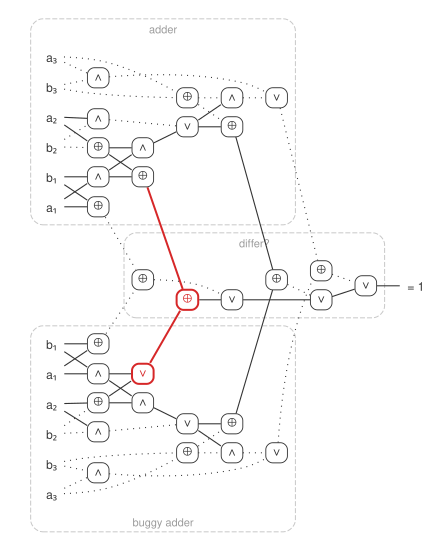
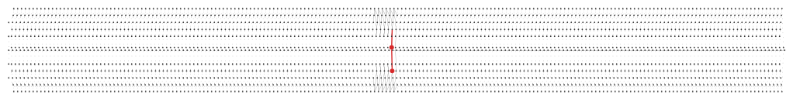

# CSets.jl

An voyage into abstraction with Itay Kadosh.

## What it does

Fast homomorphism search between C-sets, for anything with low treewidth.

## Do these two circuits compute the same function?

A circuit is a C-set: wires, plus one sort per gate type. A homomorphism into the truth tables is an evaluation of the circuit. Join two circuits into a *miter* — same inputs, compare the outputs, demand a difference — and any homomorphism is an input on which they disagree.

<p align="center"></p>

| | a | b | a + b |
|---|---|---|---|
| adder | 011 | 001 | **100** |
| buggy adder | 011 | 001 | **110** |

Solid wires carry 1, dotted wires 0. Red marks the bug and the outputs it breaks.

## At scale

<p align="center"></p>

A 200-bit miter, one column per bit. The counterexample is the red needle in the haystack.

| bits | gates | equivalent | buggy |
|---:|---:|---:|---:|
| 64 | 800 | 0.003 s | 0.003 s |
| 1,000 | 12,000 | 0.08 s | 0.13 s |
| 10,000 | 125,000 | 0.71 s | 0.71 s |

No counterexample means the circuits are equivalent: the search is exhaustive.

## Usage

```julia
h = color(X, S, Y)   # a homomorphism X → Y, or nothing
```

`S` says which elements belong together. The circuit example is in [`examples/circuits.jl`](examples/circuits.jl).
